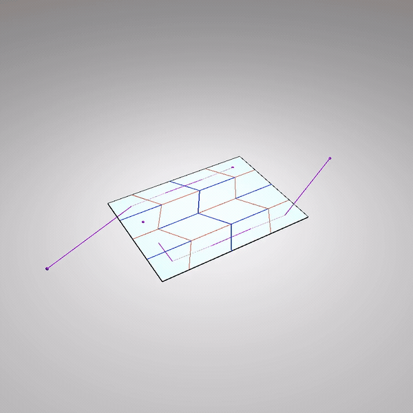
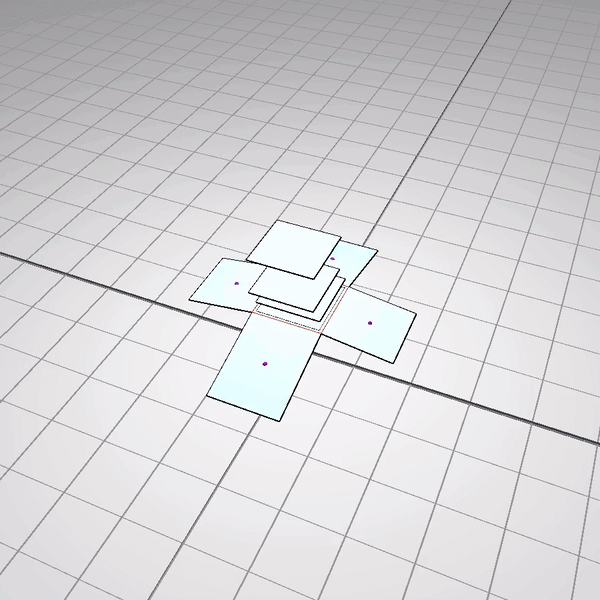
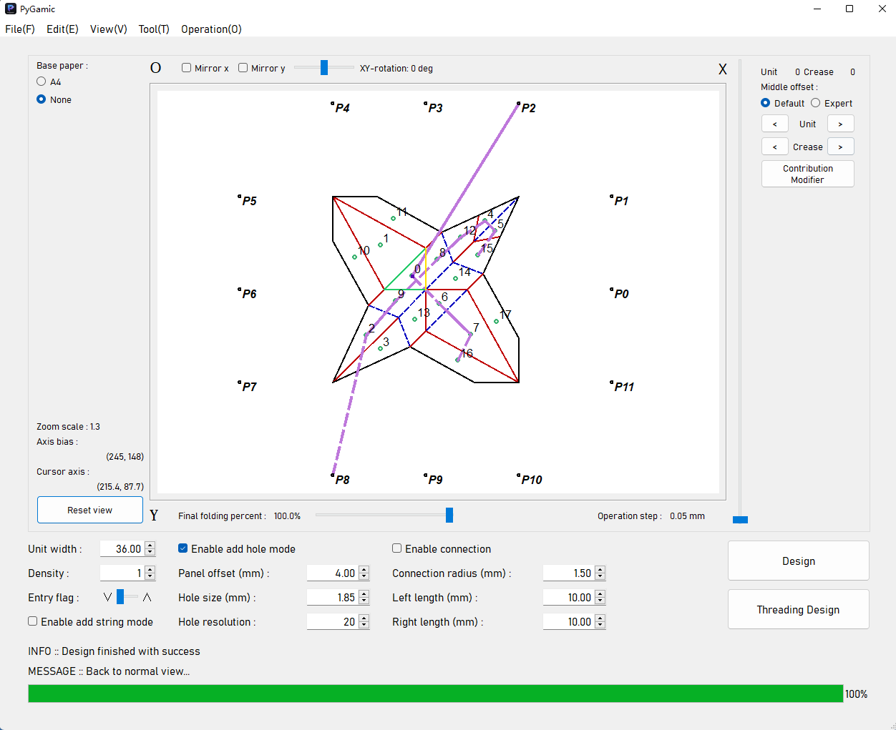
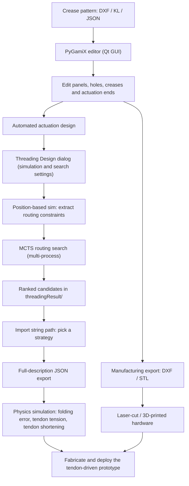
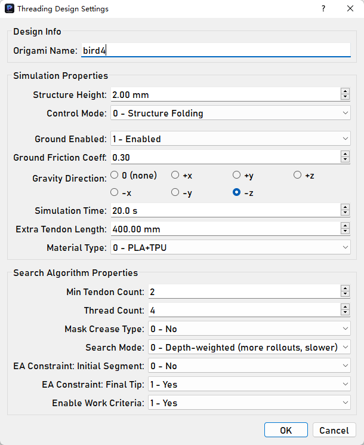
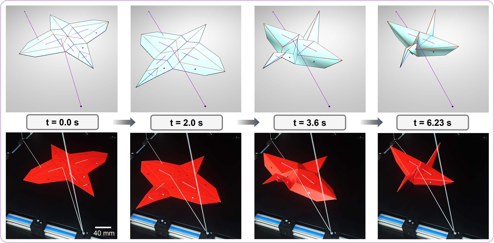

# PyGamiX

**An integrated CAD / CAM / simulation workbench for engineering origami, with automated tendon actuation design for origami structures and robots.**

[](https://www.python.org/) []() []() []() [](LICENSE) [](CHANGELOG.md)

**English** | [Chinese](README.zh-CN.md)

This is the open-source release accompanying the paper [*Design and Fabrication of String-driven Origami Robots* (ICRA 2024)](https://arxiv.org/abs/2404.09222).

<p align="center">
  
  &nbsp;&nbsp;
  
</p>

<p align="center"><em>Tendon-driven folding computed entirely by the built-in physics simulator: the tendon routes, the folding motion, and the tendon tension displayed at every moment are all simulation outputs — no physical prototype is involved.</em></p>

<p align="center">Full-length versions of the two demos above: [video1.mp4](docs/images/video1.mp4) · [video2.mp4](docs/images/video2.mp4)</p>

---

## Key features

- **Design (CAD)** — import the crease pattern (the 2D line drawing that defines how the sheet folds) from a DXF file or from parametric kinematic-line (KL) modules; then edit it interactively: set each crease's fold-angle bounds, folding order and hard-crease flags; place the holes that the tendons will pass through; place the actuation ends — the 3D anchor points, fixed in space or attached to a panel, where the actuators pull the tendons.
- **Fabrication (CAM)** — export manufacturing files directly from the design: layered DXF drawings for laser cutting, Split-DXF with hinge features for thick-panel origami, and STL models for 3D printing.
- **Physics simulation** — a physics simulator written in Taichi: panels resist in-plane stretching, creases bend like rotational springs, tendons pull on the panels through the holes with tendon–hole friction, and the structure can rest on the ground with friction under gravity; implicit time integration with an energy-based line search keeps the solving stable.
- **Automated actuation design** — given the crease pattern, the threading holes and the actuation ends, PyGamiX uses a Monte Carlo Tree Search to find complete tendon actuation strategies — which holes each tendon passes through, and how far each tendon must be contracted — a task that is slow and rarely optimal to work out by hand; candidates are ranked by simulated folding performance.
- **Sim-to-real validation** — after building the physical prototype, load its measured force–displacement recordings (CSV) and plot them together with the simulation curves in one figure, to check how well the simulation matches the hardware.

---

## Installation

**Requirements:** Windows, Python 3.9 (older Taichi / PyQt5 stack), NumPy ≤ 1.26.

```bash
git clone https://github.com/Sepkimmy-YPW/PyGamiX-V3.0.git
cd PyGamiX-V3.0
conda env create -f environment.yml   # creates the env "pygamic"
conda activate pygamic
python main.py
```

Alternatively, `pip install -r requirement.txt` in an existing Python 3.9 environment. Launch the GUI from the repository root (the code uses relative paths such as `./setting/`).

---

## Quick start

1. Launch the app: `python main.py`.
2. Open a bundled example: **File ▸ Open file...** → choose e.g. `packedImport/miura-120.json` → press **Design**. (Files in `descriptionData/` are simulator system descriptions and cannot be opened here.)
3. Save and resume: **File ▸ Save result...** (`Ctrl+S`) packs the entire design — modules, holes, crease settings, tendon routing — into one JSON file that **File ▸ Open file...** restores exactly where you left off.
4. Explore the editor — after **Design** parses the pattern, try the operations below: right-click to place a hole, double-click a crease to make it a hard crease, or draw a tendon yourself with **Enable add string mode**. Letting PyGamiX search the tendon routing automatically is described in the Workflow section.

Basic editor controls (after **Design**):

| Operation | Action |
| --- | --- |
| Mouse wheel / drag | Zoom / pan the canvas |
| **Enable add hole mode** → right-click inside a panel | Place a tendon hole (diameter set in the bottom bar) |
| **Enable add string mode** → left-click / right-click | Draw a tendon by hand — see below |
| Double-click a crease | Toggle its hard-crease flag |
| Double-click a hole / module → arrow keys, `Q` / `E` | Move the selected hole / module; rotate a module |
| `Shift` + arrow keys | Move the canvas |
| `Ctrl+Z` / `Delete` / `Esc` | Remove the last-placed hole / remove the selected hole / cancel the selection |

**Drawing a tendon by hand**: first place the actuation ends (**Edit ▸ Add Actuation Ends**: a 3D position, optionally connected to a panel), then check **Enable add string mode** and pick the tendon's start with **Edit ▸ Select Actuation Ends** — every tendon starts at an actuation end, from which it is pulled. Each further **left-click** on a panel appends a straight segment running on the same side of the sheet (top or bottom), the clicked position becoming the threading point; a **right-click** instead makes the tendon pass through the sheet at that point and continue on the opposite side. `D` undoes the last segment. Unchecking the box finishes and stores the current tendon (at least two points); check it again to draw the next one. **Edit ▸ Select Actuation Ends** can also be used at the end, so that the tendon terminates at another actuation end.

**Figure 1 — Main interface.** The crease pattern is drawn in the central canvas; editing and simulation parameters are grouped in the right panel and the bottom bar; the **Design** and **Threading Design** buttons sit in the bottom-right corner.

<p align="center">
  
</p>

---

## Workflow



1. **Import** a crease pattern (**File ▸ Import dxf** or **Import_KL...**) and press **Design** to parse it into panels and creases.
2. **Edit** — place tendon holes (**Enable add hole mode**, then right-click inside a panel; the hole diameter is set in the bottom bar), tune each crease (**Edit ▸ Edit Creases...**: fold sequence level/coeff, angle bounds, hard creases), place actuation ends (**Edit ▸ Add Actuation Ends**: a 3D position, optionally connected to a panel). Tendons can be drawn by hand (**Enable add string mode**, see Quick start) or searched automatically (step 4). `Tool ▸ Calculate Sequence` derives the fold sequence automatically.
3. **Export for manufacturing** — **File ▸ Export ▸ As Dxf...** (laser cutting), **As Split Dxf...** (hinged thick panels), **All As Stl...** (3D printing).
4. **Run the routing search** — press **Threading Design**, name the design and configure the parameters below. PyGamiX first runs a position-based folding simulation to extract routing constraints (which hole–hole and hole–actuation-end connections are physically feasible), then starts the MCTS search; ranked strategies are written to `threadingResult/` (abort with **Operation ▸ Stop Thread...**).
5. **Load a strategy** — **File ▸ Import string path**; the chosen tendon routing is drawn over the crease pattern.
6. **Evaluate in simulation** — **Tool ▸ Physical Simulation...** reports the achieved folding error, the tendon tension, and the tendon shortening over time required to drive the fold; **Tool ▸ Plot Physical Data** can draw these simulation curves together with recorded experiment data in one figure for sim-to-real comparison.

**Figure 2 — Threading Design settings dialog.**

<p align="center">
  
</p>

| Parameter | Meaning | Default |
| --- | --- | --- |
| **Origami Name** | Design name (used for the exported description file and result folder) | — |
| **Structure Height (mm)** | Initial height of the flat (unfolded) origami above the ground when the simulation starts | 1.00 |
| **Control Mode** | `0 – Structure Folding` (a single contraction folds the structure to its target shape) / `1 – Robot Actuation` (repeated contraction–release cycles drive locomotion; reveals the controller fields) | 0 |
| **Ground / Gravity** | Enable ground contact with friction (sets the friction coefficient μ); gravity direction (none, ±x/±y/±z) | off (μ = 0.3) / none |
| **Simulation Time (s)** | Max duration of one evaluation run | 20.0 |
| **Extra Tendon Length (mm)** | Length appended to each tendon outside the origami (e.g. the segment running to the clamps/actuator); it is included in the tendon's elastic model and lowers its effective stiffness | 0.00 |
| **Material Type** | `0 – PLA+TPU` / `1 – PU foam+TPU` (panel/crease materials; density and mass properties) | 0 |
| **Controller Type / Actuator Stroke Percent** | Visible in Robot Actuation mode: hardware controller type (1 or 2) and the usable fraction of the actuator stroke | 1 / 0.75 |
| **Min Tendon Count** | Lower bound on the number of tendons in the search | 1 |
| **Thread Count** | Parallel search processes (1–16) | 4 |
| **Search Mode** | `0 – Depth-weighted` (more rollouts, slower) / `1 – Uniform` (faster) | 0 |
| **Mask Crease Type** | Ignore mountain/valley crease types when building routing constraints (for patterns with unassigned creases) | off |
| **EA Constraint: Initial Segment** | External-actuation systems only: require the first segment of each tendon to run above the origami | on |
| **EA Constraint: Final Tip** | External-actuation systems only: require the final segment to run below and pass upward through the last hole, so the knotted tendon tip terminates above the origami (prevents the physical knot from lifting panels) | on |
| **Enable Work Criteria** | Pre-screen candidates by mechanical work: discard those that do negative work on the folding | on |

The two EA constraints take effect only in **external-actuation systems** (actuation ends fixed in space, not attached to any panel); they close the sim-to-real gap caused by the physical knot at the tendon tip. The search reward balances folding accuracy, completion speed, peak tendon tension and peak stress (for robots: locomotion ability); reward weights are configurable in `trainer.py`. Settings are saved per design name and pre-filled on the next run.

---

## Data formats and repository layout

- **Packed-data JSON** (your design saves, written by **File ▸ Save result...**): the complete resumable state of a design — all modules, unit biases, holes, crease features, tendon routing (`strings`) and actuation-end candidates. Store your own in `packedImport/`.
- **System-description JSON** (written by **File ▸ Export ▸ As Full-description Data...**): what the simulator and the routing search consume — key points (`kps`), crease segments (`lines`), panels (`units`), per-crease features (`line_features`) and tendon routing (`strings`).

| Path | Content |
| --- | --- |
| `packedImport/`, `importFile/` | Bundled packed-design / KL-module examples (and your own saves) |
| `descriptionData/` | System-description JSONs |
| `threadingResult/`, `dxfResult/`, `stlResult/` | Search results and export outputs (written at run time) |
| `experiment/`, `curve/` | Experiment recordings and trajectory samples for plotting |
| `docs/images/` | Figures and demo GIFs used by this README |
| `main.py`, `logic.py`, `gui/` | App entry, main window and Qt UI |
| `phys_sim25.py`, `ori_sim_sys.py`, `spatialhash.py` | Taichi physics simulator |
| `trainer.py`, `threading_design_dialog.py` | Routing-strategy search and its settings dialog |
| `dxftool.py`, `stltool2.py`, `cdftool.py` | DXF / STL output and computational-design utilities |

**Figure 3 — Sim-to-real verification.** The same tendon-driven fold at t = 0.0 / 2.0 / 3.6 / 6.23 s, simulated in PyGamiX (top) and performed by the physical prototype (bottom).

<p align="center">
  
</p>

---

## Citation

If you use PyGamiX in your research, please cite:

```bibtex
@inproceedings{yang2024design,
  title     = {Design and Fabrication of String-driven Origami Robots},
  author    = {Yang, Peiwen and Li, Shuguang},
  booktitle = {2024 IEEE International Conference on Robotics and Automation (ICRA)},
  year      = {2024},
  doi       = {10.1109/ICRA57147.2024.10610989}
}
```

## License

Distributed under the **MIT License** — see [LICENSE](LICENSE).
