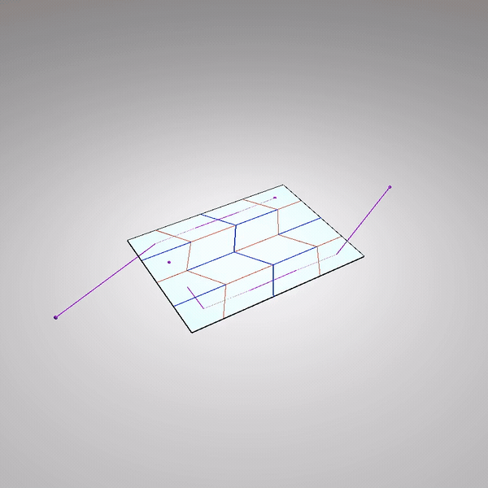
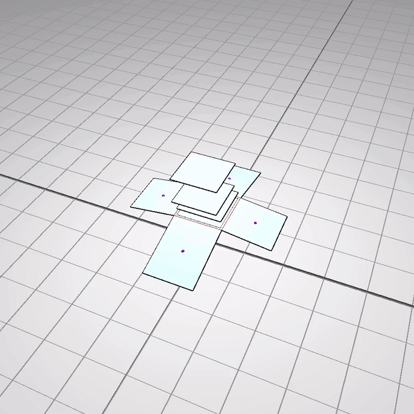
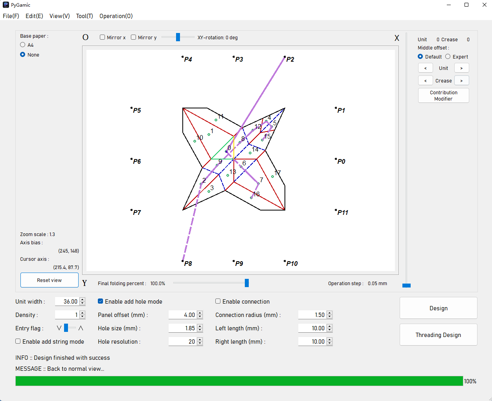
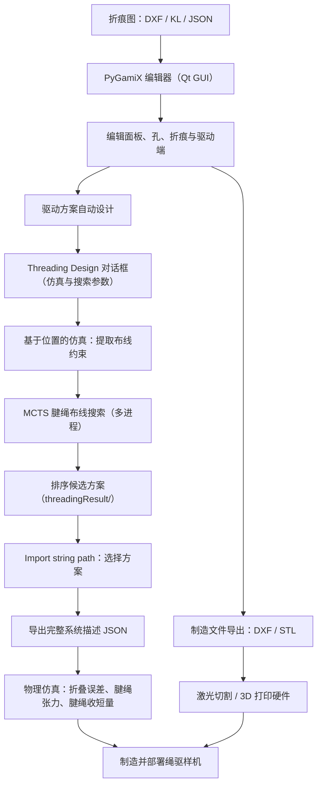
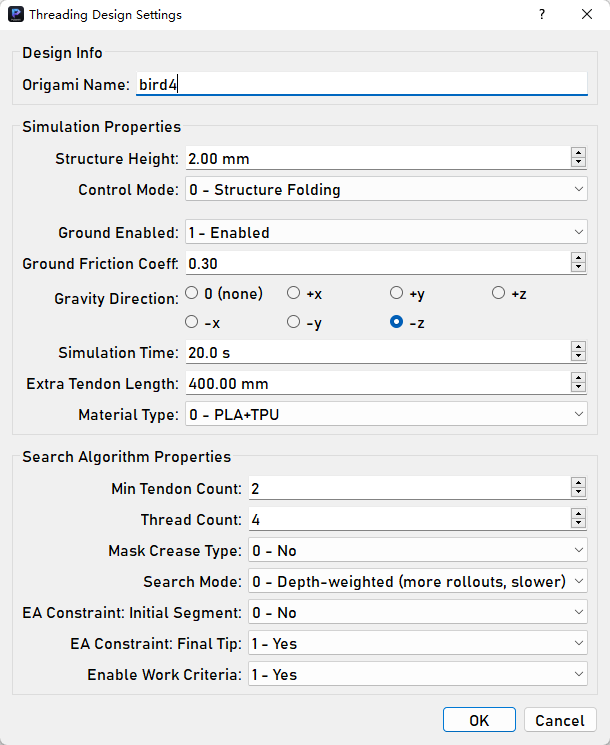
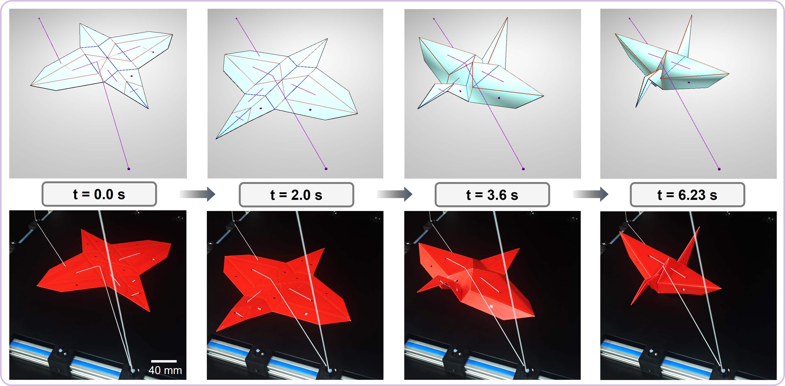

# PyGamiX

**面向工程折纸的一体化 CAD / CAM / 仿真工作台，支持折纸结构与折纸机器人的腱绳驱动方案自动设计。**

[](https://www.python.org/) []() []() []() [](LICENSE) [](CHANGELOG.md)

[English](README.md) | **简体中文**

本仓库是论文 [*Design and Fabrication of String-driven Origami Robots*（ICRA 2024）](https://arxiv.org/abs/2404.09222) 的配套开源软件。

<p align="center">
  
  &nbsp;&nbsp;
  
</p>

<p align="center"><em>两段折叠过程均由内置物理仿真器完整计算生成：腱绳沿给定路径收紧、结构逐步折叠、腱绳张力实时显示——全部为仿真结果，不涉及实物样机。</em></p>

<p align="center">上两段演示的完整视频：[video1.mp4](docs/images/video1.mp4) · [video2.mp4](docs/images/video2.mp4)</p>

---

## 核心特性

- **设计（CAD）** —— 导入折痕图（定义薄板如何折叠的二维线图）DXF 文件，或用参数化运动学线段（KL）模块拼装；随后交互式编辑：逐条设置折痕的折叠角范围、折叠顺序与硬折痕标记，布设腱绳穿过的孔位，并布置驱动端（腱绳被驱动器牵拉的锚点：输入三维坐标，可固定于空间，也可固连于某块面板）。
- **制造（CAM）** —— 从设计直接导出制造文件：激光切割用分层 DXF 线稿、厚板折纸用带铰链特征的 Split-DXF、3D 打印用 STL 模型。
- **物理仿真** —— 基于 Taichi 编写的物理仿真器：面板抵抗面内拉伸，折痕如同转动弹簧般弯折，腱绳过孔拉动面板（含腱绳与孔壁的摩擦），结构可在重力下与地面接触并受摩擦；隐式时间积分与基于能量的线搜索保证求解稳定。
- **驱动方案自动设计** —— 给定折痕图、穿线孔与驱动端后，PyGamiX 以蒙特卡洛树搜索（MCTS）自动求解完整的腱绳驱动方案——每根腱绳穿过哪些孔、需收短多少；靠人工推敲既费时又难以最优。候选方案按仿真折叠表现排序返回。
- **仿真-实物验证（sim-to-real）** —— 制作出实物样机后，导入实验测得的力-位移记录（CSV），与仿真曲线绘制在同一张图中对比，检验仿真与实物的吻合程度。

---

## 安装

**环境要求：** Windows、Python 3.9（旧版 Taichi / PyQt5 技术栈）、NumPy ≤ 1.26。

```bash
git clone https://github.com/Sepkimmy-YPW/PyGamiX-V3.0.git
cd PyGamiX-V3.0
conda env create -f environment.yml   # 创建环境 "pygamic"
conda activate pygamic
python main.py
```

或在已有的 Python 3.9 环境中 `pip install -r requirement.txt`。请务必在仓库根目录启动 GUI（程序内部使用 `./setting/` 等相对路径）。

---

## 快速开始

1. 启动软件：`python main.py`。
2. 打开内置示例：**File ▸ Open file...** → 选择如 `packedImport/miura-120.json` → 点击 **Design**。（`descriptionData/` 下是仿真器系统描述文件，不能在此处打开。）
3. 保存与恢复：**File ▸ Save result...**（`Ctrl+S`）将当前完整设计——模块、孔位、折痕设置、腱绳路径——打包为一个 JSON 文件；**File ▸ Open file...** 可随时原样恢复，从上次进度继续。
4. 上手编辑 —— 点击 **Design** 解析折痕图后，即可按下方操作编辑：右键放置孔、双击折痕设为硬折痕，或勾选 **Enable add string mode** 手动穿线。让 PyGamiX 自动搜索布线方案的方法见下文"工作流"。

**编辑器基本操作**（点击 **Design** 后可用）：

| 操作 | 作用 |
| --- | --- |
| 滚轮 / 拖拽 | 缩放 / 平移画布 |
| 勾选 **Enable add hole mode** 后在面板内右键 | 放置腱绳孔（孔径在底部工具条设置） |
| 勾选 **Enable add string mode** 后左键 / 右键 | 手动绘制腱绳——见下方说明 |
| 双击折痕 | 切换该折痕的硬折痕标记 |
| 双击孔 / 模块后按方向键、`Q` / `E` | 移动选中的孔 / 模块；旋转模块 |
| `Shift` + 方向键 | 平移画布 |
| `Ctrl+Z` / `Delete` / `Esc` | 删除最新放置的孔 / 删除选中的孔 / 取消选择 |

**手动穿线方法**：先用 **Edit ▸ Add Actuation Ends** 布置驱动端（输入三维坐标，可选择连接某块面板）；再勾选 **Enable add string mode**，用 **Edit ▸ Select Actuation Ends** 选择一个驱动端作为腱绳的**起点**——每根腱绳都从驱动端出发、被驱动器牵拉。此后**左键**点击面板：每点一次，在上一点与点击处之间添加一段贴折纸同一侧面（上侧或下侧）的直线，点击位置即穿线孔；**右键**点击则让腱绳在该点**穿过折纸**、翻到另一侧面继续走线。`D` 撤销最近一段。**取消勾选**即结束并保存当前腱绳（至少两个点），再次勾选可绘制下一根；**Edit ▸ Select Actuation Ends** 也可在收尾时再次使用，让腱绳终止于另一个驱动端。

**图 1 —— 软件主界面。** 折痕图绘制在中央画布；编辑与仿真参数分布在右侧面板与底部工具条；**Design** 与 **Threading Design** 按钮位于右下角。

<p align="center">
  
</p>

---

## 工作流



1. **导入**折痕图（**File ▸ Import dxf** 或 **Import_KL...**），点击 **Design** 解析为面板与折痕。
2. **编辑** —— 布设腱绳孔（勾选 **Enable add hole mode** 后在面板内右键，孔径在底部工具条设置）、逐条设置折痕（**Edit ▸ Edit Creases...**：折叠序列 level/coeff、角度上下界、硬折痕）、布置驱动端（**Edit ▸ Add Actuation Ends**，输入三维坐标并选择是否连接某块面板）。腱绳可手动绘制（**Enable add string mode**，操作方法见"快速开始"），也可按第 4 步自动搜索。`Tool ▸ Calculate Sequence` 可自动计算折叠序列。
3. **导出制造文件** —— **File ▸ Export ▸ As Dxf...**（激光切割）、**As Split Dxf...**（铰链厚板）、**All As Stl...**（3D 打印）。
4. **运行布线搜索** —— 点击 **Threading Design**，命名设计并配置下表参数。PyGamiX 先运行一次基于位置的折叠仿真，提取布线约束（哪些孔-孔、孔-驱动端连接在物理上可行），随后启动 MCTS 搜索，将排序方案写入 `threadingResult/`（可用 **Operation ▸ Stop Thread...** 中止）。
5. **导回方案** —— **File ▸ Import string path**；选中的腱绳路径会叠加显示在折痕图上。
6. **仿真评估** —— **Tool ▸ Physical Simulation...** 输出折叠误差、腱绳张力以及驱动折叠所需的腱绳收短量随时间的变化；**Tool ▸ Plot Physical Data** 可将仿真曲线与实验记录绘制在同一张图中对比，完成 sim-to-real 验证。

**图 2 —— Threading Design 参数设置对话框。**

<p align="center">
  
</p>

| 参数 | 作用 | 默认值 |
| --- | --- | --- |
| **Origami Name**（设计名称） | 用于命名导出的描述文件与结果目录 | — |
| **Structure Height (mm)**（结构初始高度） | 仿真开始时平摊（未折叠）折纸离地面的初始高度 | 1.00 |
| **Control Mode**（控制模式） | `0 – Structure Folding`（单次收缩将结构折叠到目标形状）/ `1 – Robot Actuation`（收缩-释放循环驱动机器人运动，展开控制器字段） | 0 |
| **Ground / Gravity**（地面 / 重力） | 启用带摩擦的地面接触（设置摩擦系数 μ）；重力方向（无、±x/±y/±z） | 关（μ = 0.3）/ 无 |
| **Simulation Time (s)**（仿真时长） | 单次评估运行的时间上限 | 20.0 |
| **Extra Tendon Length (mm)**（腱绳附加长度） | 计入每根腱绳、位于折纸之外的附加长度（如引至夹具/驱动器的绳段）；纳入腱绳弹性模型并降低其等效刚度 | 0.00 |
| **Material Type**（材料类型） | `0 – PLA+TPU` / `1 – PU foam+TPU`（面板/折痕材料，决定密度与质量参数） | 0 |
| **Controller Type / Actuator Stroke Percent** | 机器人致动模式下可见：驱动器硬件类型（1/2）与可用行程比例 | 1 / 0.75 |
| **Min Tendon Count**（最少腱绳数） | 搜索中腱绳数量的下限 | 1 |
| **Thread Count**（并行进程数） | 搜索使用的并行进程数（1–16） | 4 |
| **Search Mode**（搜索模式） | `0 – Depth-weighted`（rollout 更多、更慢）/ `1 – Uniform`（更快） | 0 |
| **Mask Crease Type**（掩蔽折痕类型） | 构建布线约束时忽略山/谷折痕类型（适用于含未指定类型折痕的图案） | 关 |
| **EA Constraint: Initial Segment**（EA 约束：首段） | 仅外部致动系统生效：要求每根腱绳首段在折纸上方走线 | 开 |
| **EA Constraint: Final Tip**（EA 约束：末端） | 仅外部致动系统生效：要求末段在折纸下方向上穿出末孔，使带绳结的腱绳端头终止于折纸上方（避免实物绳结顶起面板） | 开 |
| **Enable Work Criteria**（功判据） | 以机械功预筛候选方案：丢弃对折叠过程做负功者 | 开 |

两条 EA 约束仅在**外部致动系统**（驱动端固定于空间、不固连任何面板）中生效，用于消除实物腱绳端头绳结造成的 sim-to-real 差距。搜索奖励在折叠精度、完成速度、峰值腱绳张力与峰值应力之间权衡（机器人系统则为运动能力）；奖励权重可在 `trainer.py` 中调整；设置按设计名称保存，下次自动预填。

---

## 数据格式与目录结构

- **Packed-data JSON**（设计存档，由 **File ▸ Save result...** 写出）：一份设计的完整可恢复状态——全部模块、单元 bias、孔位、折痕特征、腱绳路径（`strings`）与驱动端候选。自己的设计建议存放在 `packedImport/`。
- **系统描述 JSON**（由 **File ▸ Export ▸ As Full-description Data...** 写出）：供仿真器与布线搜索读取——关键点（`kps`）、折痕线段（`lines`）、面板（`units`）、逐折痕特征（`line_features`）与腱绳路径（`strings`）。

| 路径 | 内容 |
| --- | --- |
| `packedImport/`、`importFile/` | 内置 packed 设计 / KL 模块示例（也可存放你自己的存档） |
| `descriptionData/` | 系统描述 JSON |
| `threadingResult/`、`dxfResult/`、`stlResult/` | 搜索结果与导出输出（运行时写入） |
| `experiment/`、`curve/` | 实验记录与轨迹示例文件 |
| `docs/images/` | README 使用的图片与演示 GIF |
| `main.py`、`logic.py`、`gui/` | 程序入口、主窗口与 Qt 界面 |
| `phys_sim25.py`、`ori_sim_sys.py`、`spatialhash.py` | Taichi 物理仿真器 |
| `trainer.py`、`threading_design_dialog.py` | 布线方案搜索与其设置对话框 |
| `dxftool.py`、`stltool2.py`、`cdftool.py` | DXF / STL 输出与计算设计工具 |

**图 3 —— 仿真与实物验证对比。** 同一次腱绳驱动折叠在 t = 0.0 / 2.0 / 3.6 / 6.23 s 的对比：上排为 PyGamiX 仿真，下排为实物样机。

<p align="center">
  
</p>

---

## 引用

若 PyGamiX 对你的研究有帮助，请引用：

```bibtex
@inproceedings{yang2024design,
  title     = {Design and Fabrication of String-driven Origami Robots},
  author    = {Yang, Peiwen and Li, Shuguang},
  booktitle = {2024 IEEE International Conference on Robotics and Automation (ICRA)},
  year      = {2024},
  doi       = {10.1109/ICRA57147.2024.10610989}
}
```

## 许可证

以 **MIT License** 分发，详见 [LICENSE](LICENSE)。
